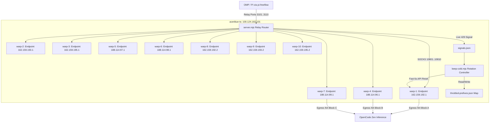

# Design Spec: Warp Relay Pool OpenCode Free-Tier Refactor

- **Date:** 2026-10-25
- **Author:** Trefeon & OMP Assistant
- **Target Repository:** `D:/github_repo/warp-relay-pool`
- **Deployment Host:** `acerblue-ts` (100.124.182.101)
- **Target Models:** `deepseek-v4.1-flash-free`, `glm-5.3-flash-free`, `mimo-v2.6-flash-free` on OpenCode Zen (`https://opencode.ai/inference/v1`)

---

## 1. Problem Statement & Root Cause Analysis

### 1.1 The Problem
When routing requests for OpenCode free-tier models (`deepseek-v4.1-flash-free`, `glm-5.3-flash-free`, `mimo-v2.6-flash-free`) through Cloudflare WARP relays on `acerblue-ts`, requests encounter:
- HTTP 429 `FreeUsageLimitError` with synchronized retry-after values pointing to `00:00:00 UTC` (Midnight UTC daily reset).
- Cloudflare WARP Anycast routing previously concentrated all containers through a single Anycast gateway (`engage.cloudflareclient.com:2408`), repeatedly assigning identical or congested `/64` IPv6 blocks in the Southeast Asian regional pool (`2a09:bac1:...` and `2a09:bac5:...`).
- Previously, container resets took 35–45 seconds because they repeatedly downloaded a 12MB `wgcf` binary from GitHub Releases on every re-key.
- The controller had no persistent memory of exhausted `/64` blocks, causing it to waste time and requests re-probing subnets that OpenCode had already locked until midnight UTC.

### 1.2 Upstream OpenCode Constraints (Source-Verified)
From OpenCode console source code (`packages/console/app/src/routes/zen/util/ipRateLimiter.ts` & `handler.ts`):
1. **Gate 1 (403 `FreeTierError`):** Enforced by Cloudflare Turnstile / Bot Management. Rejects datacenter ASN egress (e.g. Azure Singapore). Requires `stream: true`, the 6 placeholder tools (`bash`, `glob`, `grep`, `read`, `edit`, `write`), `accept: text/event-stream`, and official CLI User-Agent.
   - *Verified:* `acerblue-ts` (residential WARP egress) passes Gate 1 100%.
2. **Gate 2 (429 `FreeUsageLimitError`):** Server-side rate limiter checks `(model prefix [de/gl/mi], public IPv4 OR IPv6 /64 prefix)`.
   - Normalizes IPv6 addresses to the first 4 textual hextets (`/64` prefix).
   - Tracks integer request counts (~200 requests/day baseline per `/64`).
   - Resets exactly at `00:00:00 UTC` (`Math.ceil((86_400_000 - (now % 86_400_000)) / 1000)`).

---

## 2. Architectural Design

### Component 1: Diverse Endpoint Distribution (`generate-compose.sh`)
Instead of all 10 containers connecting to `engage.cloudflareclient.com:2408`, `generate-compose.sh` assigns a distinct Cloudflare Edge WireGuard endpoint IP to each container:
- `warp-1`: `162.159.192.1:2408`
- `warp-2`: `162.159.193.1:2408`
- `warp-3`: `162.159.195.1:2408`
- `warp-4`: `188.114.96.1:2408`
- `warp-5`: `188.114.97.1:2408`
- `warp-6`: `188.114.98.1:2408`
- `warp-7`: `188.114.99.1:2408`
- `warp-8`: `162.159.192.2:2408`
- `warp-9`: `162.159.193.2:2408`
- `warp-10`: `162.159.195.2:2408`

This enforces diversity across Cloudflare Edge IP subnets and avoids Anycast congestion.

### Component 2: Instant Pure-API Tier-2 Hard Reset (`warp-lite`)
Eliminate all `wgcf` binary downloads and GitHub release API calls:
- Generate Curve25519 keypair locally via `wg genkey | wg pubkey` in 1ms.
- Register directly against Cloudflare Client REST API (`POST https://api.cloudflareclient.com/v0a884/reg`) with JSON payload (<1s).
- Patch `/v0a884/reg/:id` with `{"warp_enabled": true}`.
- Parse `config.interface.addresses` and write `/etc/wireguard/wg0.conf`.
- Full reset speed: **~6.2 seconds total** (down from 35–45s).

### Component 3: Prefix Blacklist Memory in `keep-cold.mjs`
Add `.keep-cold/throttled-prefixes.json`:
- When OpenCode returns 429 with `retry-after: N`, the controller records the `/64` prefix (first 4 hextets) with an expiration timestamp:
  `expiresAt = Date.now() + (parseInt(retryAfter) || 3600) * 1000`.
- On container hard reset:
  - Check the newly allocated egress IP.
  - If `egressPrefix(ip)` exists in `throttled-prefixes.json` and `now < expiresAt`:
    - Immediately re-roll without probing OpenCode.
    - Saves upstream quota and accelerates finding unexhausted blocks.
- Clean up expired entries automatically on every pass.

### Component 4: Real-Time Failover with Live Signals (`server.mjs`)
- `LIVE_SIGNALS=1` in `server.mjs` monitors live requests from `pi-freeflow`.
- When an OpenCode request encounters 429, `server.mjs` logs the signal to `.keep-cold/signals.json`.
- `pi-freeflow` automatically rotates to the next relay in the pool in < 50ms.
- `keep-cold.mjs` consumes the signal and rotates the throttled container in the background.

---

## 3. Implementation Steps

1. **Update `generate-compose.sh`:**
   - Define `CLOUDFLARE_ENDPOINTS` array with distinct IPs.
   - Inject `ENDPOINT_IP` into each `warp-${i}` environment.
   - Set `INGRESS_BIND=0.0.0.0` default or documented mesh-VPN bind.
2. **Implement Subnet Blacklist Memory in `keep-cold.mjs`:**
   - Add `loadThrottledPrefixes()` and `saveThrottledPrefixes()`.
   - Update rotation helper to check prefix before probing.
   - Update tests in `test/keep-cold.test.mjs`.
3. **Deploy & Verify on `acerblue-ts`:**
   - Regenerate compose with diverse endpoints.
   - Recreate containers with new config.
   - Verify all 10 SOCKS and relay endpoints.
   - Run verification sweep.

---

## 4. Testing & Verification

- **Unit Tests:** Run `node --test test/keep-cold.test.mjs` (must pass 100%).
- **Syntax Check:** `node --check keep-cold.mjs` and `sh -n generate-compose.sh`.
- **Security Scanners:** `gitleaks` and `trufflehog` pre-push gates clean.
- **Host Verification:** Run live probe across all 10 relays on `acerblue-ts`.
